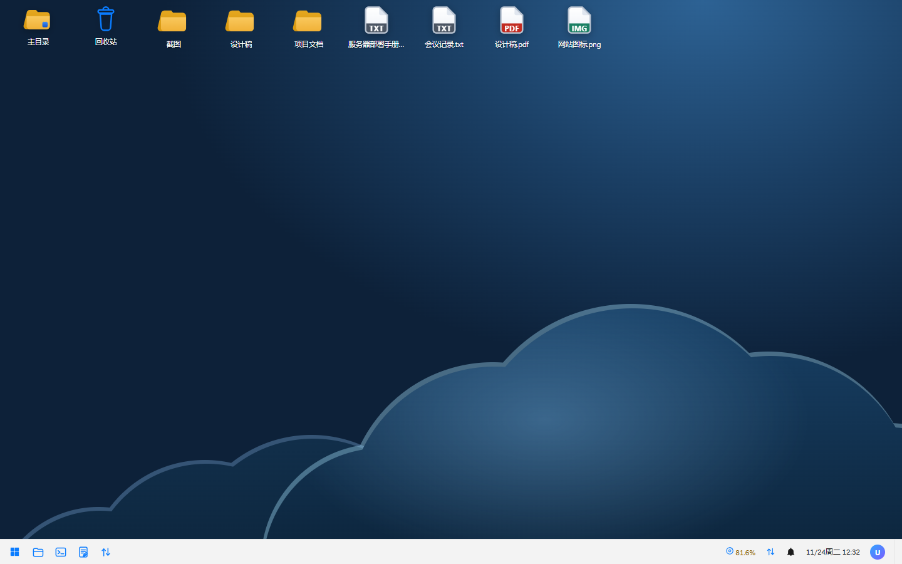
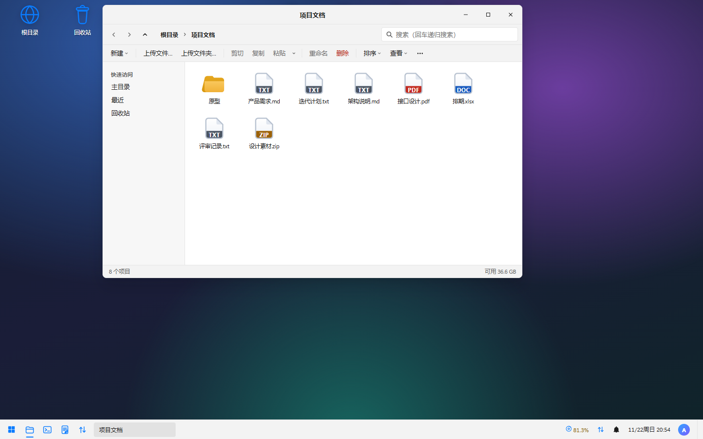

# CloudNine

自托管的单用户云桌面：部署到自己的服务器，浏览器打开就是一台 Windows 11 风格的桌面。桌面即主目录，文件、终端、编辑器、预览与分享都在同一个界面里完成。





## 应用场景

- 手里只有一台云服务器，想在浏览器里管理文件，不想再装 NAS。
- 经常 SSH 进服务器改代码，希望文件、终端、编辑器在一个窗口里切换。
- 需要把服务器上的文件临时发给同事，又不想开公共网盘。

## 功能特色

**Win11 外壳**

- 底部任务栏 + 开始菜单，每个窗口一个按钮（悬停标题、右键跳转），`Alt+Tab` 仅在系统未拦截时生效
- 开始菜单搜索应用与命令，Esc 或点击外部收起
- 拖动窗口到屏幕左右边缘占半屏、到顶部最大化，拖离还原
- 亮 / 暗两套 Fluent 主题，通知与右键菜单跟随
- 手机浏览器自动切换为单屏移动形态

**文件管理**

- 桌面直览主目录：新建、上传、重命名、拖拽移入、拖到回收站
- 框选与多选，批量复制、剪切、删除
- 文件资源管理器：地址栏、命令栏、递归搜索、图标 / 列表视图
- 压缩包解压、批量打包下载、回收站保留 30 天

**终端与编辑**

- 真实 PTY 终端，多标签、断线自动重连
- CodeMirror 6 编辑器，语法高亮、保存即写入
- 图片、音视频、PDF、Markdown、Office 文档预览，图片支持缩放手势

**传输与分享**

- 分片断点续传、文件夹上传
- 单文件或多文件打包下载
- 带密码与有效期的分享链接，可随时撤销

**安全**

- bcrypt 密码、登录限流、HttpOnly 会话
- 文件接口做路径规范化与根目录边界校验
- 分享令牌不可枚举

**插件**

- 插件是一份纯静态前端包（`plugin.json` + 入口 HTML），装进 `<DATA_DIR>/plugins/<id>/` 后就和内置应用一样出现在桌面、开始菜单里，双击打开成窗口
- 页面跑在 `<iframe sandbox="allow-scripts allow-forms">` 里，只能通过宿主提供的少量能力工作：私有存储（1MB）、读 / 写 `FILE_ROOT` 内的文本文件、写剪贴板、弹桌面通知；没有后端、拿不到终端
- 示例插件：`examples/plugins/hello`（主题色块 + 计数）、`examples/plugins/todo`（待办清单）；改完跑 `node scripts/plugin-dev-install.mjs todo`，刷新浏览器即可
- 清单字段、权限、错误码、通信协议、打包上传与自测脚本见 **[docs/plugins.md](docs/plugins.md)**

## 技术栈

| 层 | 选型 |
| --- | --- |
| 前端 | React 18 + Vite + CodeMirror 6 + xterm.js |
| 后端 | Node.js ≥ 18 + Express + ws + node-pty |
| 存储 | 本地文件系统 + JSON 数据库 |
| 部署 | systemd + nginx，单机自托管 |

## 快速开始

```bash
npm run install:all   # 安装前后端依赖
npm run build         # 构建前端
npm start             # 启动服务，默认 :8480
```

打开 http://localhost:8480，首次访问通过初始化向导创建唯一账号。

## 部署与文档

生产环境的配置项、环境变量、nginx 与 systemd、部署脚本、测试和安全须知见 **[docs/deploy.md](docs/deploy.md)**。

License: [MIT](LICENSE)
